# UI design notes

Status: v3. Visitor screens: map and search, with pin details and the regional guide in one sheet over the map. Resident submission form (機能A). Admin screens follow.
Figma: [DevFest Local Guide — UI Design](https://www.figma.com/design/ctPaGb5iH6U3wCt648823f). It holds flows, wireframes, components, screens, motion, and `06 — Evolution`.
How the design got here: [evolution/README.md](evolution/README.md).

| Home                                         | Pin selected (half sheet)                           | Regional guide (full sheet)                 |
| -------------------------------------------- | --------------------------------------------------- | ------------------------------------------- |
| 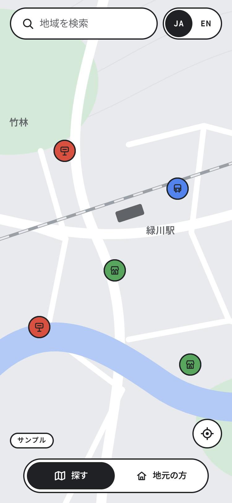 | 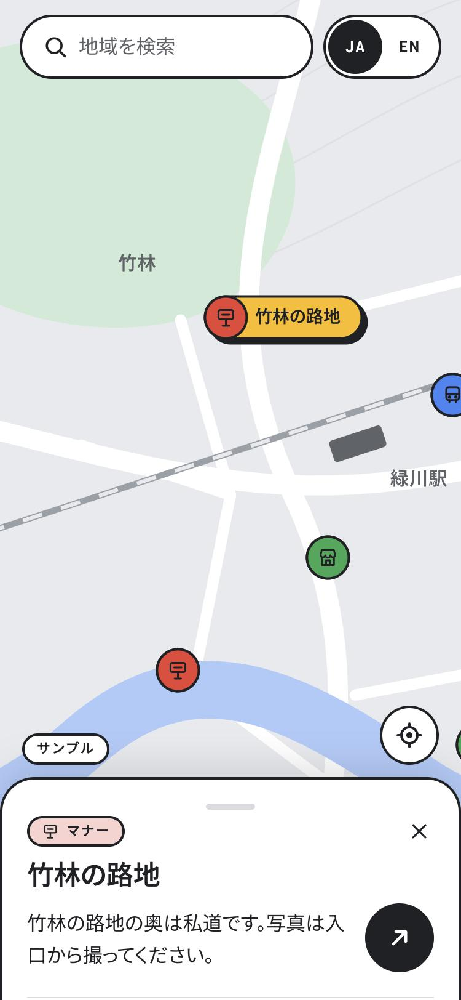 | 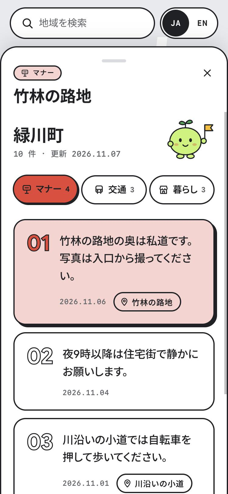 |

| Desktop, pin selected (English)                            | Desktop, guide panel (English)                  |
| ---------------------------------------------------------- | ----------------------------------------------- |
| 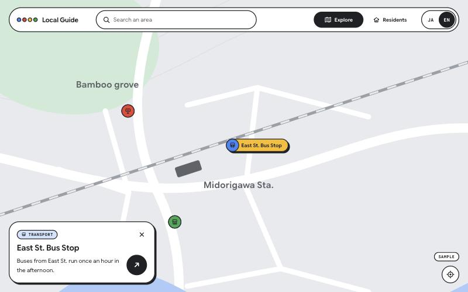 | 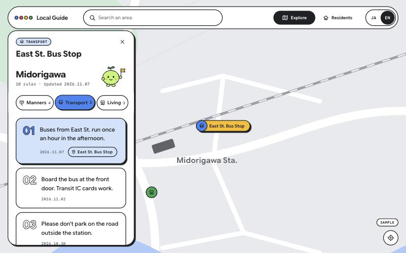 |

## Bottom row (shared)

`BottomBar` is the same on every screen, so the nav never moves between pages and its thumb can slide. One full-width row: 探す / 地元の方 and the location button, both 56px tall, 16px from each edge, with the マナビ wordmark directly above. The row sits 30px above the bottom so the Google logo, "Map data" credit and Terms link stay visible; the Maps terms require them. The optional "Keyboard shortcuts" link is kept for keyboard users. While the sheet is open, the row is hidden and the wordmark and location button ride on top of the sheet. On the resident form the right-hand slot is the round yellow send button (paper plane, `aria-label` 送信する); after sending, an empty slot keeps the nav the same width. The form fades out under the row.

## Guide ordering (scales to many rules)

Each category tab has two parts:

1. **地域全体 / Whole area**: rules without a location (rubbish days, buses). A short fixed list first.
2. **場所ごと / By place**: rules with a location, nearest first from the tapped pin, or from the visitor when location is on, with a distance tag (「ここ」 for the tapped pin, else 120 m / 1.2 km). With no reference point they are newest first.

Posts are merged and approved before they become rules, so the guide stays a curated document rather than a feed. Next steps if volume grows: show the nearest few with 「もっと見る」, cluster pins when zoomed out, and smaller areas (ward or district) with the API returning only rules in view.

## Resident form (機能A)

| Form | Picking a place | Sent | Desktop (English) |
| --- | --- | --- | --- |
| 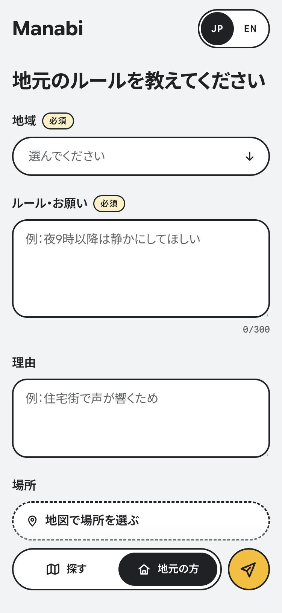 | 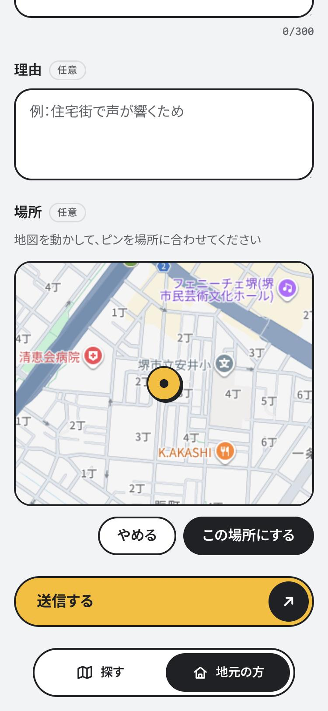 | 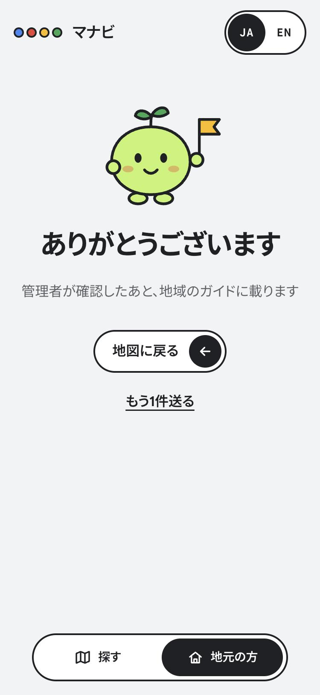 | 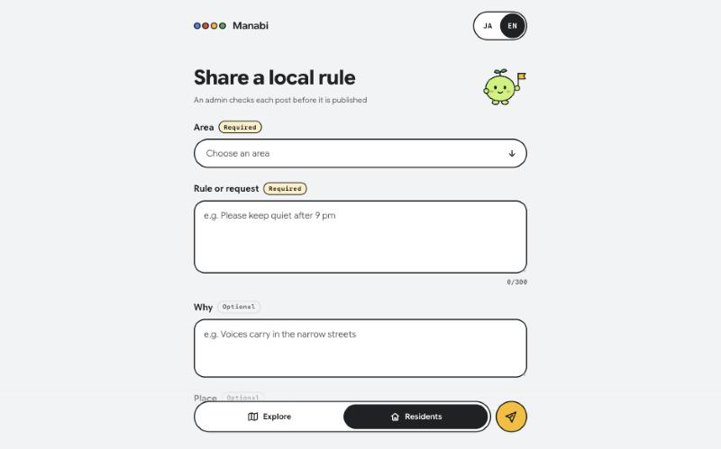 |

`/contribute`, reached from 地元の方 in the nav. Fields follow the team spec and the 2026-11-08 location agreement:

| Field | Rule | Maps to `POST /api/posts` |
| --- | --- | --- |
| 地域 Area | required; custom dropdown that opens directly under the field (the native menu opens on top of it on macOS and cannot be styled) | `region` |
| ルール・お願い Rule or request | required, up to 300 characters | `text` |
| 理由 Why | optional, up to 300 characters | `reason` |
| 場所 Place | optional; move the map under a fixed centre marker, then "この場所にする" | `location` (`lat`, `lng`) |

- No optional badges, no helper sentence and no mascot on the form: only required fields carry a 必須 badge. Validation runs on send: the first missing field gets focus, a light red tint and one line of red text. No blue focus ring; focused fields lift with the hard shadow.
- The place picker needs the live map. Without a key the confirm button stays disabled.
- Sending is mocked and goes to the thank-you screen, which says an admin checks posts before they are published. It becomes `POST /api/posts` when the endpoint (#10) is ready.

## Admin (機能D)

| Sign-in | Candidates | Published rules | Desktop (English) |
| --- | --- | --- | --- |
| 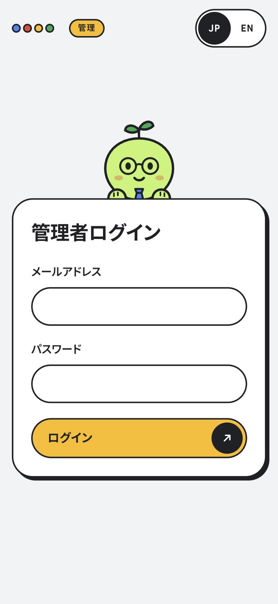 | 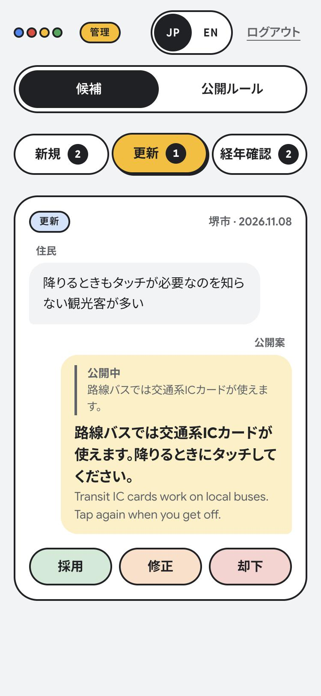 | 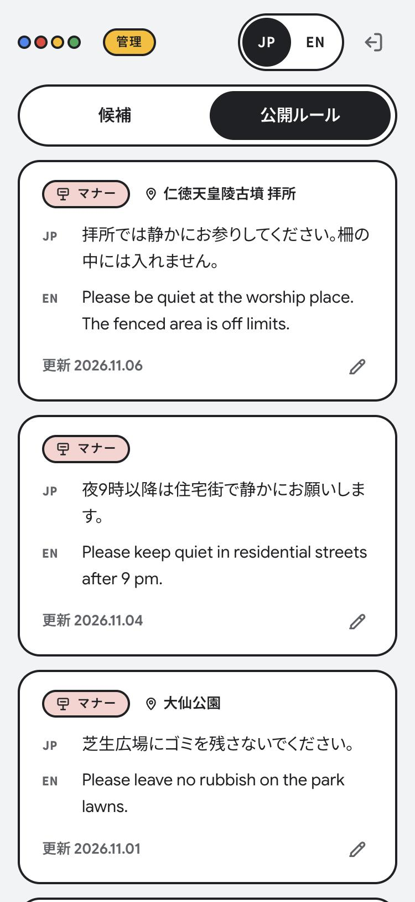 | 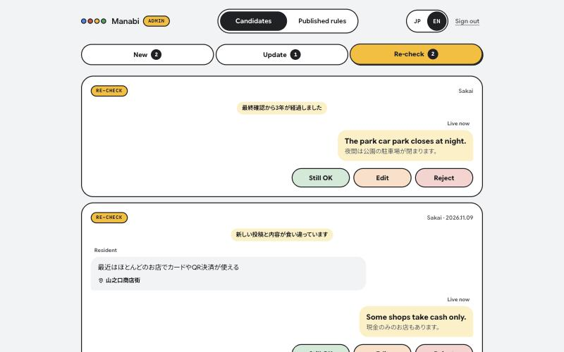 |

Routes: `/admin` (sign-in), `/admin/candidates?type=add|update|review`, `/admin/rules`. Same tokens and components as the visitor side, with a 管理 tag next to the brand so admins always know where they are.

- **Sign-in.** The card sits a little above the middle of the screen with the manager (the guide sprout in round glasses and a blue tie) peeking over its top edge, paws on the card. The manager is decorative (`aria-hidden`) and reacts to the form:

  | Form | Manager |
  | --- | --- |
  | Nothing focused | Eyes follow the pointer |
  | Email focused | Looks down and reads along as the address grows |
  | Password focused | Covers its eyes with both paws |
  | Missing fields or wrong password | Round eyes, flat mouth, a blue "?" and a small head shake |
  | Signed in | Happy eyes, a hop and a wave, then the queue opens (600ms; at once with reduced motion) |

- **Header.** One pill switch only: 候補 / 公開ルール. The candidate filters 新規 (add), 更新 (update), 経年確認 (re-check) are flat tabs with pending counts and a sliding underline; they roll down under the switch on 候補 and roll away on 公開ルール. Sign out is an icon (named ログアウト / Sign out for screen readers), so the row does not shift when the language changes. Decisions and counts are kept while switching between the two views.
- **Each card reads as a short chat**, so it stays compact:
  - the resident (住民) on the left: their post and place, nothing else (their "why" is left out; the worry says enough);
  - the draft rule (公開案) on the right: the UI language in bold, the other language small beneath. When it would replace a live rule, that rule is quoted at the top like a chat reply (公開中);
  - a re-check reason is a centred system note, like a chat's date line. For a re-check the right bubble is the live rule itself, so it is labelled 公開中.
- Region and date sit top right in Google Sans Flex; no section labels or dividers.
- **Actions** are three equal pills in one row, colour-coded and without icons: 採用 / 問題なし (green), 修正 (orange), 却下 (red); English: Approve / Still OK, Edit, Reject. They follow the #24 proposal:

  | Candidate | 採用 / 問題なし | 修正 | 却下 |
  | --- | --- | --- | --- |
  | 新規 add | new rule | new rule with edited text | nothing published |
  | 更新 update | rule text replaced | edited text | rule unchanged |
  | 経年確認 review | 問題なし: only the last-checked date moves | edited text | rule unchanged |

- 修正 turns the draft bubble into JP/EN fields at full width, with 保存 / やめる.
- A decided card collapses to one row with 元に戻す (undo), so a mis-tap is cheap. When a tab is cleared, the mascot says so.
- **Published rules** card: category and place on top, JP/EN text at full width, and a footer with the updated date on the left and a pencil icon (named 編集 / Edit plus the rule, for screen readers) in the bottom-right corner. Editing swaps the text for JP/EN fields and the pencil for やめる / 保存 in the same footer; saving moves the updated date and shows 保存しました.
- Sign-in, decisions and edits are mocked in local state. They become Firebase sign-in, `PATCH /api/admin/candidates/{id}` (`{"action": "approve" | "reject", "statement"?: {ja, en}}`) and `PATCH /api/admin/rules/{id}`.

## Direction

Google's own visual language, as used on the DevFest GDGoC Japan Hackathon site: light grey ground, white surfaces with 2px ink outlines, Google blue, red, yellow and green, pill shapes, small monospace tags and bold Google Sans headlines. Hover states are playful: outlined things lift with a hard offset shadow, arrows turn, dots hop.

The home screen is only a search bar and the map. Nothing opens a new page: as in Google Maps, a pin raises a sheet over the map. Half height shows the statement; dragging up (or the arrow) expands the same sheet into the regional guide, a readable document split into Manners, Transport and Living tabs. Dragging down or × returns to the map.

| Source                       | Pattern used                                                                                              | Not used                                               |
| ---------------------------- | --------------------------------------------------------------------------------------------------------- | ------------------------------------------------------ |
| Google colour sheet          | Blue, red, yellow, green and their light tints; light grey and near-black                                 | Deep and orange tones beyond status use                |
| Google Sans Flex             | Latin UI and display type, with Google Sans Code for tags and dates                                       | Shipping the 3.9 MB TTF; Fontsource woff2 is used      |
| DevFest hackathon site video | Outlined pills and cards, round black arrow buttons, mono tags, JA/EN pill switch, hover lifts, dot trios | Countdown, marquee strip, photography, Google branding |
| Team review (2026-11-08)     | Simpler home, statement-only preview, icon action, tabs in the guide, clearer language switch, mascot     | —                                                      |

## Team review applied

| Feedback                                              | Change                                                                                                             |
| ----------------------------------------------------- | ------------------------------------------------------------------------------------------------------------------ |
| SpotPreview should not show the reason field          | Preview shows category tag, place name and the statement only                                                      |
| Open the regional guide as a web page after a pin     | The guide opens in the same sheet over the map (v3.1). `/regions/:id` links still work and redirect into the sheet |
| "View Details" was unclear                            | One round arrow button (`aria-label` "ガイドを開く" / "Open guide")                                                |
| No category chips on home                             | Removed. Home is search + map                                                                                      |
| Switch categories with tabs inside the guide          | Manners / 交通 Transport / 暮らし Living tabs, sticky under the hero, with counts                                  |
| EN/JP switch hard to understand; reachable everywhere | JP \| EN segmented switch with a sliding thumb, top-right on every screen; keeps screen and state                  |
| Minimise text; no tagline                             | No tagline or helper copy; states are one line                                                                     |
| Mascot                                                | One-head-tall lime sprout with a tour flag; appears on the guide hero, holding and empty states                    |

## Wireframes

Mobile, the primary layout:

```
Home                              Pin · half sheet                  Guide · full sheet (same sheet)
+-------------------------------+ +-------------------------------+ +-------------------------------+
| ( Search an area )   (JP|EN)  | | ( Search an area )   (JP|EN)  | | ( Search an area )   (JP|EN)  |
|                               | |                               | |                               |
|            MAP                | |        (● Place name)         | | Region name          (mascot) |
|     (●)       (●)             | |    (●)                        | | 10 rules · Updated 2026.11.07 |
|          (●)                  | | [Sample]                 (◎)  | | (Manners 4)(Transport 3)(Living 3)
|   (●)            (●)          | | +---------------------------+ | | +---------------------------+ |
| [Sample]                 (◎)  | | | [MANNERS]             ×   | | | | 01  Statement            | |
|                               | | | Place name                | | | |     2026.11.06 (⌖ place) | |
|                               | | | Statement only.      (↗)  | | | +---------------------------+ |
|    ( Explore | Residents )    | | +---------------------------+ | | | 02  Statement            | |
+-------------------------------+ |    ( Explore | Residents )    | | +---------------------------+ |
                                  +-------------------------------+ +-------------------------------+
```

Desktop, 900px and wider: one outlined header pill across the top (brand, search, Explore | Residents, JP | EN). The sheet becomes a left panel, as in Google Maps on the web: a card at half height, full height when expanded. Location sits bottom-right.

## Components

| Component        | Purpose                                                | Variants and states                          | Accessibility                                                                              |
| ---------------- | ------------------------------------------------------ | -------------------------------------------- | ------------------------------------------------------------------------------------------ |
| `AppNav`         | Visitor and resident areas                             | current item                                 | `aria-current="page"`, 44px items                                                          |
| `BrandMark`      | Product name, home link                                | —                                            | `h1` on home; dots are decorative                                                          |
| `SearchBar`      | Find an area                                           | focus                                        | labelled input in a search landmark                                                        |
| `LanguageSwitch` | JP/EN from any screen                                  | ja, en                                       | nav landmark; options named 日本語 / English, 44px                                         |
| `MapMarker`      | Opens a pin                                            | category × default, hover, selected, dimmed  | link with the full name, 44px target                                                       |
| `MapPlaceholder` | Stands in for Google Maps                              | ready, loading                               | hidden from assistive tech                                                                 |
| `LocationButton` | Shows the visitor on the map | default, locating (blue ring pulses), on (lifted onto the hard shadow, the only visual change; tap again to turn off); no hover effect, denied (dashed, crossed) | toggle button: `aria-pressed`, `aria-busy` while locating |
| YouMarker | The visitor on the map | — | the mascot stands on the position, blue halo at its feet; marker title 現在地 / You are here |
| `PlaceSheet`     | Pin detail and regional guide over the map             | half, full; dragging (phones)                | section labelled by the title; handle is a button with `aria-expanded`; × and Escape close |
| `Tag`            | Small mono label                                       | plain, manners, transport, living, highlight | text label                                                                                 |
| `PillLink`       | Primary or back action                                 | highlight, plain                             | text link                                                                                  |
| `StateCard`      | Empty, error and holding states                        | plain, warning                               | `role="status"`                                                                            |
| `Mascot`         | Character                                              | guide, puzzled                               | `aria-hidden`                                                                              |
| `Select` | Single-choice dropdown in the app style | closed, open, invalid | ARIA select-only combobox: arrows, Home/End, Enter/Space, Escape, type to jump; closes on outside tap |
| `GuideContent`   | Region intro, category tabs and rules inside the sheet | category tab; focused rule                   | tabs are a nav with `aria-current`, 48px; rules are an ordered list                        |
| Rule card        | One published statement                                | default, hover, focused                      | ordered list; pin chip named "Show on map: place", 44px hit area                           |
| `AdminHeader` | Admin brand, 候補 / 公開ルール switch, JP/EN, sign-out icon; candidate filter tabs roll down under it | mobile, desktop; filters open, closed | nav with `aria-current`; closed filters are `inert`; sign-out icon has an `aria-label`; each page has a screen-reader `h1` |
| `ManagerMascot` | Admin sign-in character on the card edge | idle, email, password, error, happy | decorative, `aria-hidden`; animations off with reduced motion |
| `CandidateCard` | One candidate in the admin queue, as a short chat | add, update, review; editing; approved, rejected (collapsed with undo) | list item labelled by its `h2`; editor fields labelled 日本語 / 英語; 44px buttons |

## Review states

Every state is reachable by URL, so reviewers need no backend.

| State                      | URL                                                                         |
| -------------------------- | --------------------------------------------------------------------------- |
| Home                       | `/`                                                                         |
| English                    | `/?lang=en`                                                                 |
| Pin selected (half sheet)  | `/?spot=rule_001`                                                           |
| Search results             | `/?q=緑`                                                                    |
| Empty search               | `/?q=tokyo` or `/?state=empty`                                              |
| Location denied            | `/?state=denied`                                                            |
| Loading                    | `/?state=loading`                                                           |
| Error                      | `/?state=error`                                                             |
| Full sheet, tab and focus  | `/?spot=rule_005&sheet=full&tab=transport`                                  |
| Guide from search (no pin) | `/?region=sakai&sheet=full` (old `/regions/sakai` redirects here) |
| Resident form | `/contribute` |
| Form, send failed | `/contribute?state=error` |
| Form, sent | `/contribute?step=done` |
| Holding page               | `/admin` (any unknown path)                                          |

## Data shape

Sample rules follow the team's public JSON format in `docs/詳細設計.md`: `id`, `region`, `statement` (ja/en), `updated_at`, plus the optional `location` (`lat`, `lng`) the team agreed on 2026-11-08 for Post, Candidate and Rule.

- Rules with a `location` get a pin on the map; every rule appears in the regional guide.
- Tapping a pin uses the rules already loaded for the region; no extra API.
- Still to agree with the backend: `category` (for the Manners / Transport / Living tabs) and a place name (the sheet title for a pin). Both are UI-only fields in `src/content/types.ts` for now.
- The reason field residents may enter is not shown to visitors.

The sample region is 堺市 (Sakai), the team's demo region. Its rules are illustrative, labelled as samples, and their positions are approximate.

## Tokens

Source of truth: `src/styles/tokens.css`. Figma variables in the `Tokens` collection carry the same values and `var(--…)` code syntax.

- Colour: Google palette (`--g-blue`, `--g-red`, `--g-yellow`, `--g-green` and light tints), light grey ground `#f1f3f4`, ink `#202124`, soft ink `#5f6368`. Categories: Manners red, Transport blue, Living green. Yellow marks what is selected or primary. Lime `#c6f36d` is the mascot only.
- Type: Google Sans Flex (Latin), Noto Sans JP (Japanese), Google Sans Code (tags, dates, counts). All via Fontsource variable woff2 with unicode-range subsets; about 60 KB of gzipped CSS.
- Shape: 2px ink outlines; radius 12, 20, 28, full; hard shadow `4px 4px 0` ink.
- Spacing: 4, 8, 12, 16, 20, 24, 32, 40.

## Numerals

Outlined numbers (rule numbers and any future step numbers) must show one clean outline per glyph. Some Google Sans Flex glyphs, such as 4, are built from overlapping shapes, so a plain text stroke draws lines inside them.

- Code: `-webkit-text-stroke: 3px` with `paint-order: stroke fill`, filled with the card colour. The fill hides the inner lines and leaves a 1.5px outline. Hover and focus fill with the category colour.
- Figma: two stacked layers in a `Number` frame, `Outline` (3px stroke) under `Fill` (card colour).

## Motion

| Trigger                       | Elements          | Behaviour                                                                                                                                                                | Duration                                |
| ----------------------------- | ----------------- | ------------------------------------------------------------------------------------------------------------------------------------------------------------------------ | --------------------------------------- |
| Select marker | Map canvas | One smooth pan that ends with the pin exactly in the centre (no follow-up nudge) | Google Maps `panTo` |
| Select marker                 | Marker            | Drops in, turns yellow, name expands, hard shadow                                                                                                                        | 320ms spring                            |
| Tap a pin                     | Place sheet       | Rises to half height; desktop card rises 24px                                                                                                                            | 380ms                                   |
| Hover marker                  | Pin               | Hops 4px with an ink shadow underneath                                                                                                                                   | 200ms spring                            |
| Hover pill, card, search      | Outlined surfaces | Lifts 2px with a 4px hard offset shadow                                                                                                                                  | 200ms                                   |
| Hover arrow action            | Round ink arrow   | Turns 45° to point forward                                                                                                                                               | 320ms spring                            |
| Switch language               | Thumb             | Slides between JP and EN; screen stays put                                                                                                                               | 320ms spring                            |
| Switch area (探す / 地元の方) | AppNav thumb | Slides on the current screen first; the page changes when it lands (`useSlideNavigate`), so building the next screen (the map is heavy) never eats the slide. Labels swap colour as it passes. Overshoot scaled to the same ~4px as the language switch | 320ms, cubic-bezier(0.34, 1.3, 0.64, 1) |
| Admin switch (候補 / 公開ルール) | AdminHeader thumb | Same slide and curve as the visitor nav. Rule: every two-option pill switch with an ink thumb slides this way, on the visitor and admin side alike | 320ms, cubic-bezier(0.34, 1.3, 0.64, 1) |
| Candidate filters | Underline | Slides to the chosen tab; the filter row rolls down on 候補 and away on 公開ルール | 320ms |
| Hover rule card               | Outlined numeral  | Fills with the category colour                                                                                                                                           | 200ms                                   |
| Drag sheet / tap arrow        | Place sheet       | Follows the finger, then snaps to full, half or closed by distance and speed; guide rules rise 40ms apart                                                                | 380ms                                   |
| Hover brand                   | Four dots         | Hop in sequence, 60ms apart                                                                                                                                              | 480ms                                   |
| Idle                          | Mascot            | Bob, blink, flag sway; sprout tilts on hover                                                                                                                             | 3.2s / 4.6s / 2.4s                      |
| Loading                       | Four dots         | Hop in sequence                                                                                                                                                          | 900ms loop                              |

All motion stops under `prefers-reduced-motion: reduce`.

## Decisions

| Decision                                         | Why                                                                                     | Rejected                                        |
| ------------------------------------------------ | --------------------------------------------------------------------------------------- | ----------------------------------------------- |
| Google palette and outlined "sticker" surfaces   | Fits a Google event, reads as designed rather than templated, playful on hover          | v2 monochrome with a lime accent                |
| Category colours on pins, tags and tabs          | One colour per category links the map, preview and guide                                | Monochrome pins                                 |
| Home is search + map only                        | Team review: keep the first screen simple                                               | Category chips in the header                    |
| Guide in a sheet over the map, as in Google Maps | Fewer page changes; the map and context stay put; drag is familiar to Google Maps users | A separate guide page (v3.0)                    |
| Statement only in the preview                    | Public data has a statement; the reason is resident input for admins                    | Note / Why / Checked rows                       |
| Arrow icon instead of "詳しく見る"               | One obvious action; the label lives in `aria-label`                                     | A text button that did not say where it goes    |
| Segmented JP \| EN switch, top-right everywhere  | Both options visible, current one obvious                                               | A single toggle showing only the other language |
| Own brand mark (four dots)                       | Google colours without using Google or GDG logos                                        | Any Google logo                                 |
| State held in the URL                            | Keeps this PR free of application logic and makes states reviewable                     | Component state                                 |
| Fictional sample town                            | Avoids inventing rules for a real place; demo region is Sakai                           | Rules for a real municipality                   |

## Open questions

- Product name: 「マナビ」 / "Manabi" is a placeholder, used for the brand, the map wordmark (white halo like the Google Maps mark; on phones it sits on top of the bottom row, on desktop beside the location button) and the page title.
- Mascot name.
- Whether the backend can return `category` and a map position per rule.
- Swap the sample town for Sakai data once the API returns real rules.

## Mocked

Search matching and all rules are static sample data. The location button uses the browser Geolocation API: it asks for permission on the first tap, then the mascot stands on the visitor's position (YouMarker) and follows them while it is on. Tapping again turns it off: the mascot disappears, tracking stops, the position is forgotten and the map stays where it is. The position stays in the browser and is never sent. Away from the demo region (over 15 km), a 「堺市に戻る」 pill moves the map back. Refusing shows the location-off notice. For presentations, `?demo=1` makes the button place the visitor at a fixed spot in central 堺市 (near the city office, zoomed out one step to show the pins) without asking for permission; it sticks for the browser tab, and `?demo=0` or closing the tab turns it off. The map is the Google Maps JavaScript API when `VITE_GOOGLE_MAPS_API_KEY` is set in `.env` (markers are `AdvancedMarker`s with our own design, using `VITE_GOOGLE_MAP_ID`); without a key, or if the key is rejected, the static placeholder drawing is shown instead. Sending the resident form is mocked, and so is the admin side (see Admin).
