# Design evolution

A record of how the visitor UI changed and why. Earlier versions are kept as screenshots here and as frozen images on the Figma page `06 — Evolution`, so later component changes never alter them.

## v1 · Paper (2026-11-06)

| Mobile                                         | Pin selected                                      | Desktop                                           |
| ---------------------------------------------- | ------------------------------------------------- | ------------------------------------------------- |
| 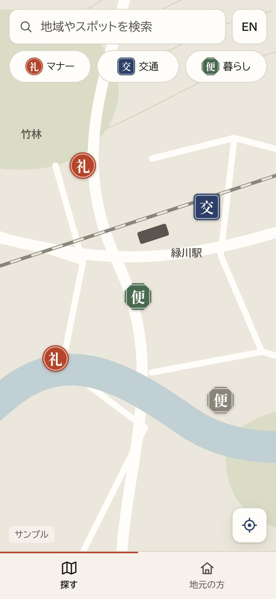 | 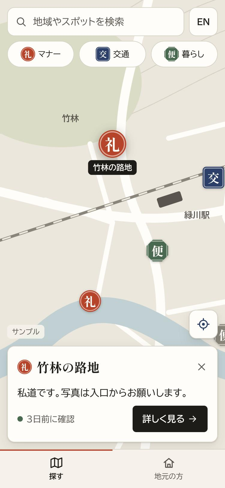 | 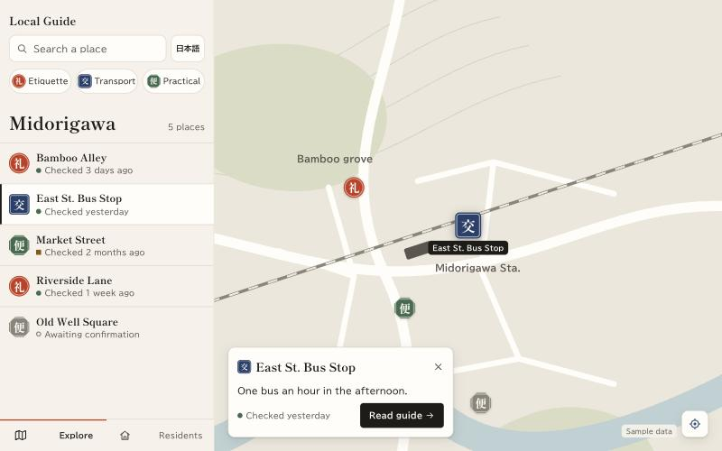 |

Cream paper, serif headings, clay red accent and kanji seal markers (礼 交 便).
Why it changed: with few references it read as a generic template, and the seals looked decorative rather than useful.

## v2 · Mono + lime (2026-11-07)

| Mobile                                        | Pin selected                                     | Desktop                                          |
| --------------------------------------------- | ------------------------------------------------ | ------------------------------------------------ |
| 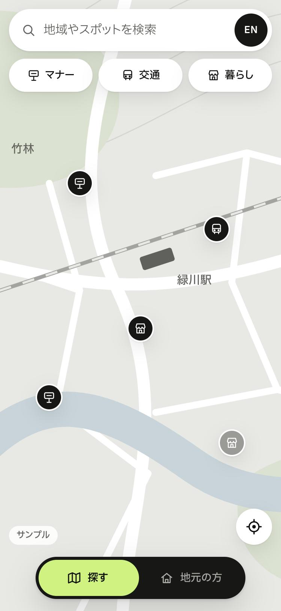 | 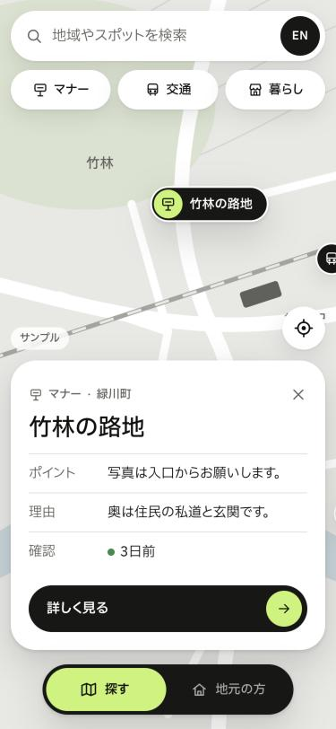 | 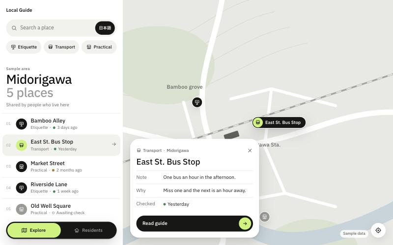 |

Rebuilt from travel-app references: neutral grey, near-black pills, one lime accent, IBM Plex Sans JP, label/value rows in the spot sheet. Ported from Next.js to React + Vite to match the team stack.
Why it changed (team review):

- The home screen carried category chips; the team wanted search + map only.
- The spot sheet showed the reason field; visitors only need the statement.
- "詳しく見る" did not say what would open.
- The single EN/日本語 toggle was hard to read.
- No regional guide page yet.

## v3 · Google (2026-11-08)

| Home                                          | Pin selected                                       | Regional guide                          |
| --------------------------------------------- | -------------------------------------------------- | --------------------------------------- |
| 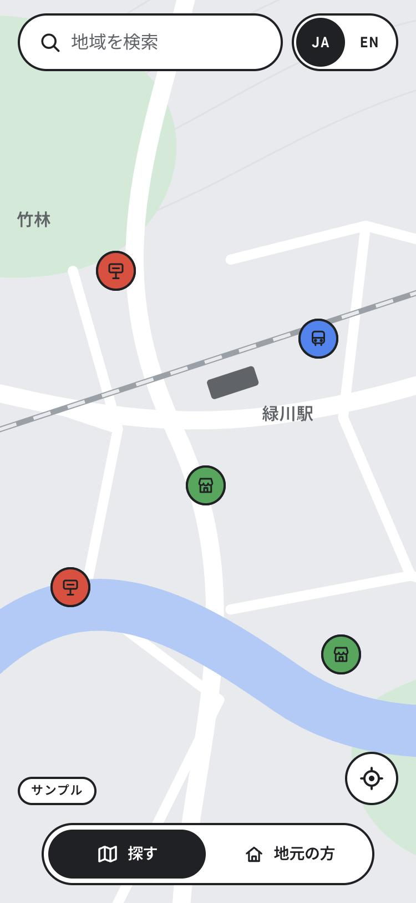 | 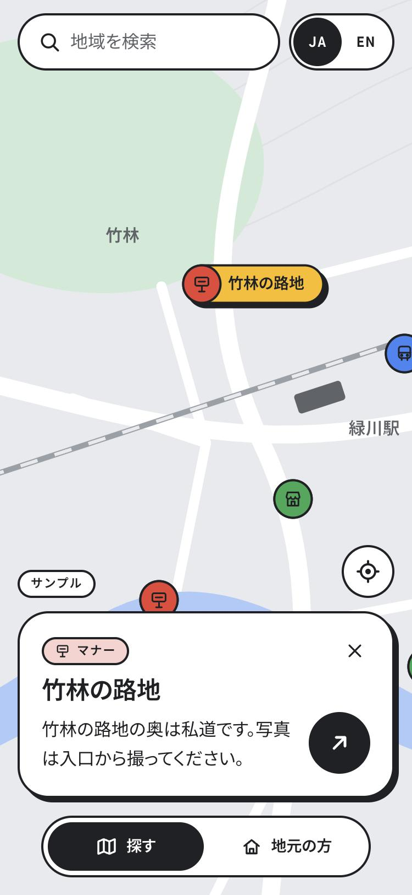 | 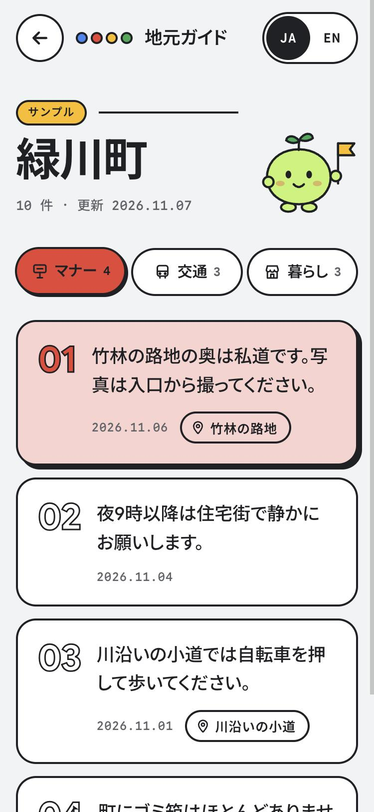 |

| Desktop (English)                                  | Desktop guide                                    |
| -------------------------------------------------- | ------------------------------------------------ |
| 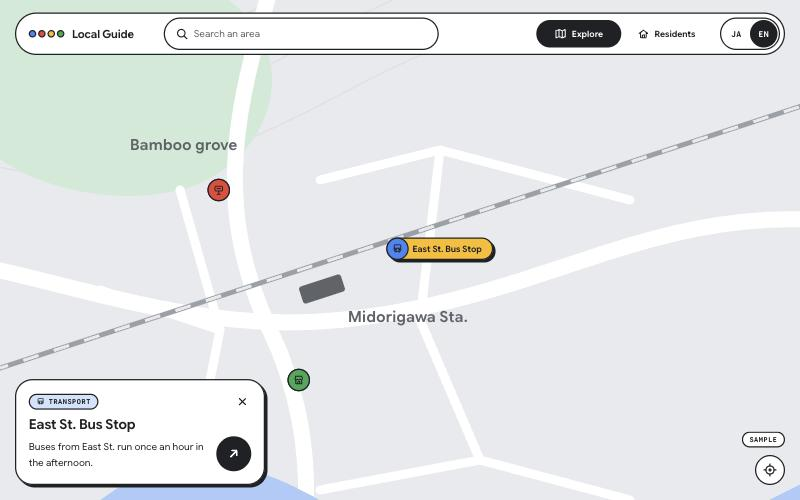 | 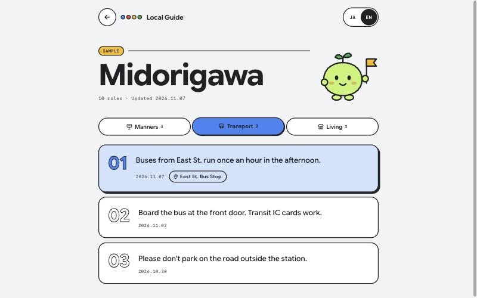 |

Google colour sheet, Google Sans Flex, and patterns from the DevFest GDGoC Japan Hackathon site: outlined pills and cards, mono tags, round arrow buttons, hard-shadow hover lifts. All of the team review is applied, plus a mascot.

| Area       | v1                 | v2                        | v3                                               |
| ---------- | ------------------ | ------------------------- | ------------------------------------------------ |
| Palette    | Cream, clay red    | Grey, near-black, lime    | Google blue, red, yellow, green                  |
| Type       | Serif + sans       | IBM Plex Sans JP          | Google Sans Flex, Noto Sans JP, Google Sans Code |
| Markers    | Kanji seals        | Dark dots, lime selection | Category colour dots, yellow selection pill      |
| Home       | Search, chips, map | Search, chips, map, list  | Search and map only                              |
| Pin detail | Sheet with text    | Note / Why / Checked rows | Statement only, arrow into the guide             |
| Guide      | —                  | —                         | Web document with category tabs                  |
| Language   | "EN" button        | Toggle inside search      | JA \| EN switch, top-right everywhere            |
| Character  | —                  | —                         | Lime sprout guide                                |

### v3.1 · One sheet over the map (2026-11-08)

Following Google Maps, the regional guide no longer opens as a separate page. A pin raises a half sheet with the statement; dragging up expands the same sheet into the guide with Manners / Transport / Living tabs; dragging down or × returns to the map. On desktop the sheet is a left panel. The v3 screenshots above show the earlier separate guide page.

| Half sheet                                             | Full sheet                                     | Desktop panel                                      |
| ------------------------------------------------------ | ---------------------------------------------- | -------------------------------------------------- |
| 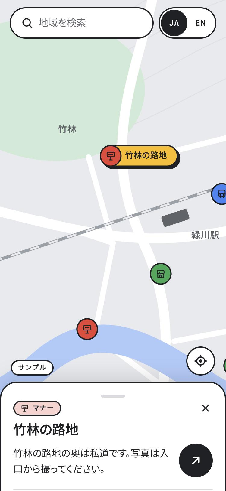 | 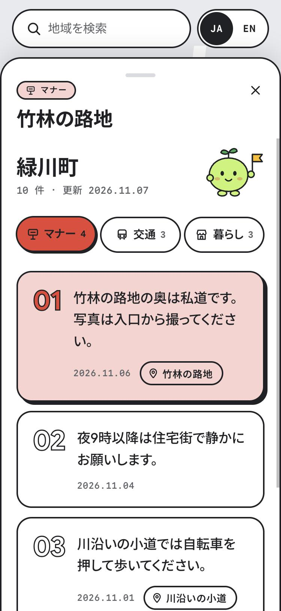 | 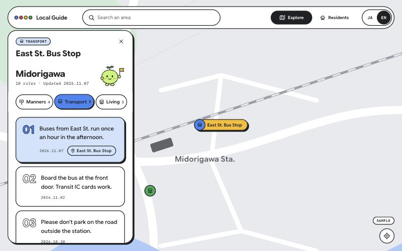 |

### v3.2 · Manabi wordmark and the manager (2026-11-09)

The four colour dots become the name itself: "Manabi" in plain ink, on every visitor and admin screen; the letters hop one after another on hover, as the dots did. Two coloured versions were tried first (one Google colour per letter, with and then without the ink outline) and dropped: the outlined one was hard to read and the plain one looked off next to the rest of the UI. The black マナビ over the phone map stays as it was. The v3 screenshots above keep the dot version.

On the admin side the 管理 pill is gone. Sign-in shows the manager (the guide sprout in round glasses and a tie) with a 管理者専用！ / Admin only! thought bubble; once signed in, a small manager head next to the wordmark marks admin-only territory.

| Sign-in                                         | Signed in                                             | Resident form                                         |
| ----------------------------------------------- | ----------------------------------------------------- | ----------------------------------------------------- |
| 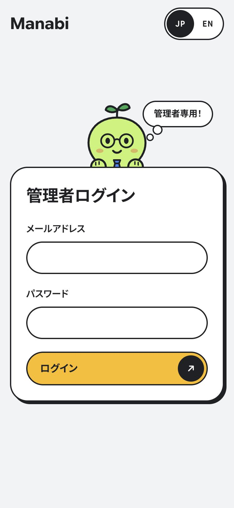 | 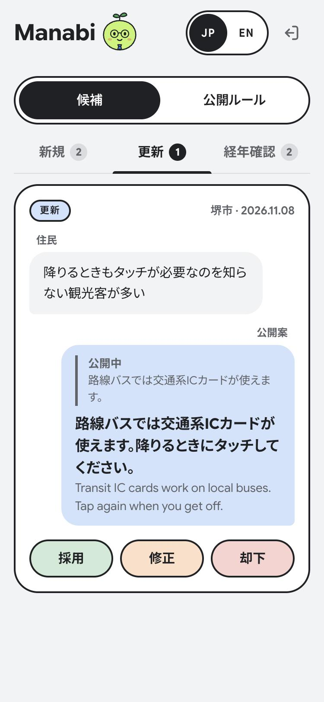 | 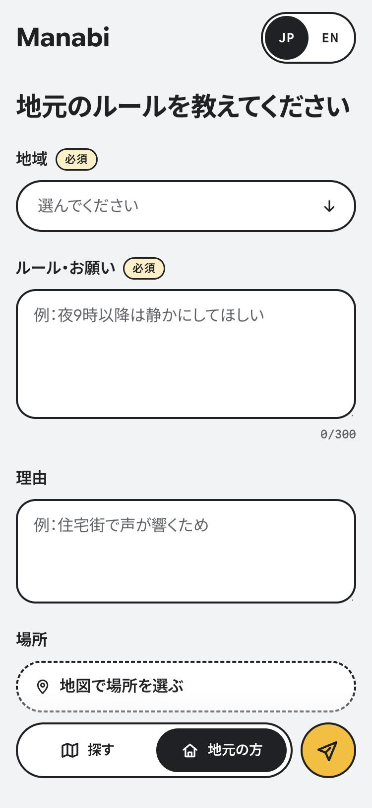 |
